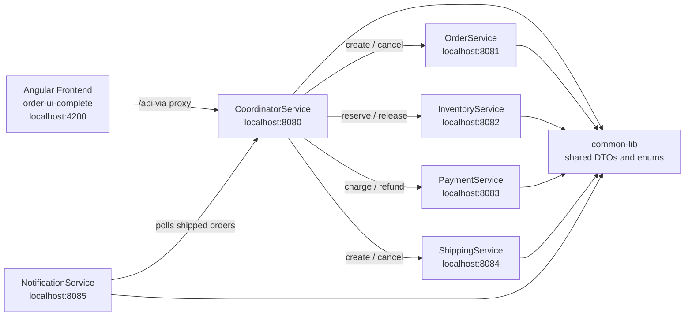
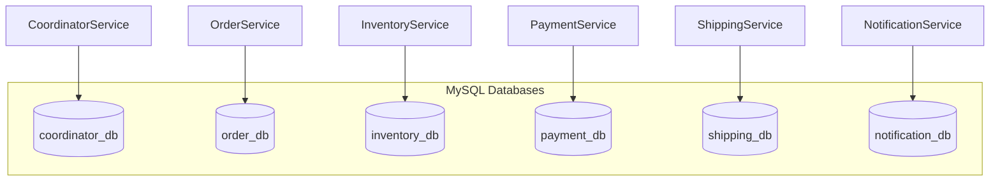
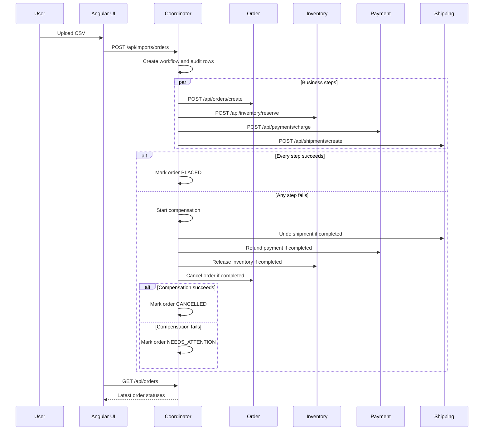
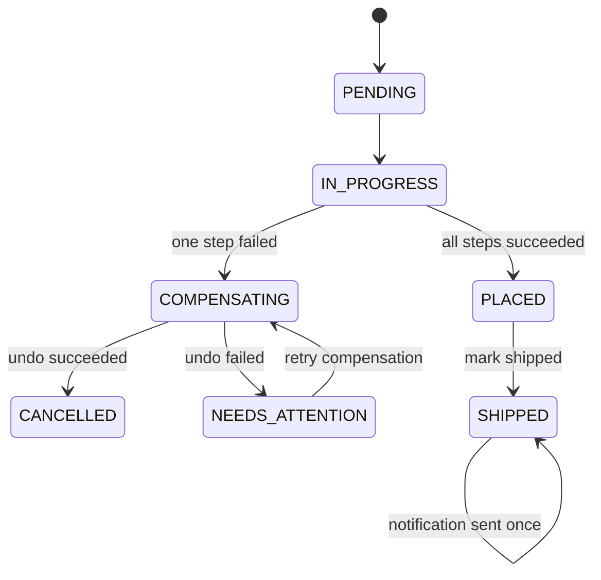
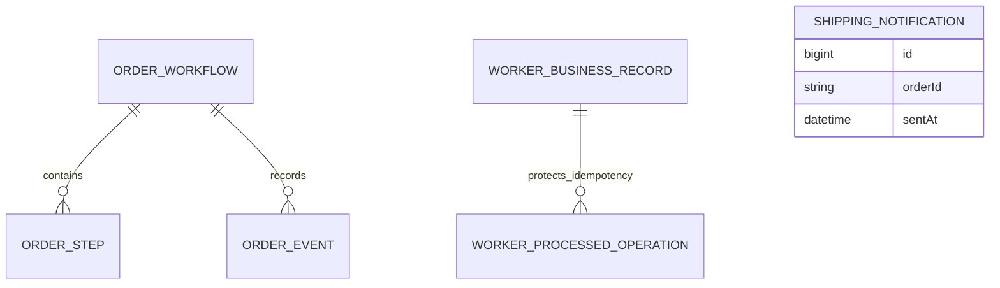

# Distributed Order Processing System

A Spring Boot microservices assignment for CSV-driven order processing with saga-style orchestration, compensation, audit history, shipment notifications, and an Angular dashboard.

## What This Project Does

The application imports order rows from CSV files and processes each order through four business services:

1. Order creation
2. Inventory reservation
3. Payment charge
4. Shipment creation

The `CoordinatorService` runs these steps in parallel, tracks every step, and decides the final order state:

- `PLACED` when all business steps succeed
- `CANCELLED` when a step fails and all completed steps are successfully undone
- `NEEDS_ATTENTION` when a step fails but one or more undo operations also fail
- `SHIPPED` after a placed order is manually marked as shipped

The frontend lets you upload CSV files, inspect order details, retry failed compensation, mark placed orders as shipped, and reset all test data.

## Architecture





## Request Flow



## Order State Machine



## Repository Structure

```text
order-processing/
|-- pom.xml                         Parent Maven aggregator
|-- common-lib/                     Shared DTOs and enums
|-- CoordinatorService/             Main orchestration API and saga state
|-- OrderService/                   Order create/cancel worker
|-- InventoryService/               Inventory reserve/release worker
|-- PaymentService/                 Payment charge/refund worker
|-- ShippingService/                Shipment create/cancel worker
|-- NotificationService/            Scheduled shipped-order notification worker
|-- order-ui-complete/              Angular frontend
|-- test-data/                      Ready-to-upload CSV demo files
|-- src/                            Root Spring Boot scaffold, not the main runtime
```

The root folder has a Spring Boot scaffold, but the root `pom.xml` is mainly used as a Maven parent and aggregator. The runnable backend applications are the service modules listed above. For normal testing, run the individual services, not the root `src/main` app.

## Service Responsibilities

| Module | Port | Database | Role |
|---|---:|---|---|
| `CoordinatorService` | `8080` | `coordinator_db` | Imports CSV files, creates workflows, calls workers, records steps/events, handles compensation, exposes UI API |
| `OrderService` | `8081` | `order_db` | Creates order records and cancels them during compensation |
| `InventoryService` | `8082` | `inventory_db` | Reserves stock and releases it during compensation |
| `PaymentService` | `8083` | `payment_db` | Charges payment and refunds it during compensation |
| `ShippingService` | `8084` | `shipping_db` | Creates shipment records and cancels them during compensation |
| `NotificationService` | `8085` | `notification_db` | Polls shipped orders and records exactly one notification per shipped order |
| `common-lib` | N/A | N/A | Shared `StepRequest`, `StepResponse`, statuses, step names, and action types |

## Backend Data Model



`CoordinatorService` owns the workflow truth. Worker services keep their own business records plus processed operation records so repeated requests can be handled safely.

## API Summary

### Coordinator API

| Method | Endpoint | Purpose |
|---|---|---|
| `POST` | `/api/imports/orders` | Upload a CSV file of orders |
| `GET` | `/api/orders?page=0&size=20` | List workflows for the dashboard |
| `GET` | `/api/orders/{id}` | View workflow details, step statuses, and events |
| `POST` | `/api/orders/{id}/mark-shipped` | Move a placed order to `SHIPPED` |
| `POST` | `/api/orders/{id}/retry-compensation` | Retry undo work for `NEEDS_ATTENTION` orders |
| `GET` | `/api/orders/internal/shipped` | Internal endpoint used by `NotificationService` |
| `POST` | `/api/test/reset` | Clears test data in coordinator, workers, and notifications |

### Worker APIs

| Service | Execute | Undo |
|---|---|---|
| `OrderService` | `POST /api/orders/create` | `POST /api/orders/cancel` |
| `InventoryService` | `POST /api/inventory/reserve` | `POST /api/inventory/release` |
| `PaymentService` | `POST /api/payments/charge` | `POST /api/payments/refund` |
| `ShippingService` | `POST /api/shipments/create` | `POST /api/shipments/cancel` |

Every service also exposes:

```text
POST /api/test/reset
GET  /actuator/health
```

## CSV Format

CSV files must use this header:

```csv
order_id,customer_id,product_id,quantity,amount,fail_at,comp_fail_at
```

| Column | Meaning |
|---|---|
| `order_id` | Business order ID. Re-uploading the same ID is treated as duplicate/idempotent behavior. |
| `customer_id` | Customer identifier. |
| `product_id` | Product/SKU identifier. |
| `quantity` | Quantity requested. |
| `amount` | Payment amount. |
| `fail_at` | Optional step failure trigger: `ORDER`, `INVENTORY`, `PAYMENT`, or `SHIPPING`. |
| `comp_fail_at` | Optional compensation failure trigger: `ORDER`, `INVENTORY`, `PAYMENT`, or `SHIPPING`. |

## Included Test CSVs

Upload files from `test-data/` through the Angular UI or the import API.

| File | Expected result |
|---|---|
| `01_all_steps_success_placed.csv` | All orders become `PLACED` |
| `02_payment_fails_order_cancelled.csv` | Payment fails; completed steps are undone; orders become `CANCELLED` |
| `03_inventory_fails_order_cancelled.csv` | Inventory fails; previous completed steps are undone; orders become `CANCELLED` |
| `04_shipping_fails_order_cancelled.csv` | Shipping fails; order, inventory, and payment are undone; orders become `CANCELLED` |
| `05_order_step_fails_order_cancelled.csv` | Order step fails early; order becomes `CANCELLED` |
| `06_undo_refund_fails_needs_attention.csv` | Shipping fails, refund undo fails; orders become `NEEDS_ATTENTION` |
| `07_undo_inventory_release_fails_needs_attention.csv` | Shipping fails, inventory release fails; orders become `NEEDS_ATTENTION` |
| `08_duplicate_reload_same_file.csv` | First upload creates orders; second upload demonstrates duplicate handling |
| `09_mixed_bulk_demo.csv` | Mixed success, cancellation, and needs-attention examples |
| `10_mark_shipped_notification_demo.csv` | Place an order, mark it shipped, and let notification scheduler record it |

## Prerequisites

- Java 21 or newer
- Maven wrapper included in this repository
- Node.js and npm for the Angular UI
- MySQL 8 or compatible server running locally

Default database credentials are:

```text
username: root
password: 1234
```

You can override database settings with environment variables:

```powershell
$env:DB_USERNAME="root"
$env:DB_PASSWORD="your-password"
```

Each service uses its own database and creates it automatically with `createDatabaseIfNotExist=true`.

## Run The Backend

First install the parent and shared library:

```powershell
.\mvnw.cmd install -N -DskipTests
.\mvnw.cmd -pl common-lib install -DskipTests
```

Open separate PowerShell terminals and start the services:

```powershell
cd D:\order-processing\OrderService
..\mvnw.cmd spring-boot:run
```

```powershell
cd D:\order-processing\InventoryService
..\mvnw.cmd spring-boot:run
```

```powershell
cd D:\order-processing\PaymentService
..\mvnw.cmd spring-boot:run
```

```powershell
cd D:\order-processing\ShippingService
..\mvnw.cmd spring-boot:run
```

```powershell
cd D:\order-processing\CoordinatorService
..\mvnw.cmd spring-boot:run
```

```powershell
cd D:\order-processing\NotificationService
..\mvnw.cmd spring-boot:run
```

Recommended startup order:

```text
OrderService -> InventoryService -> PaymentService -> ShippingService -> CoordinatorService -> NotificationService
```

## Run The Frontend

```powershell
cd D:\order-processing\order-ui-complete
npm install
npm start
```

Open:

```text
http://localhost:4200
```

The Angular proxy forwards `/api` calls to:

```text
http://localhost:8080
```

## Quick API Demo

Upload a success CSV:

```powershell
curl.exe -F "file=@test-data\01_all_steps_success_placed.csv" http://localhost:8080/api/imports/orders
```

List orders:

```powershell
curl.exe http://localhost:8080/api/orders?page=0^&size=20
```

Reset all test data:

```powershell
Invoke-RestMethod -Method Post http://localhost:8080/api/test/reset
```

The reset endpoint is intended for development and testing. Disable it outside local testing with:

```powershell
$env:TEST_RESET_ENABLED="false"
```

## Build And Test

Backend:

```powershell
.\mvnw.cmd test
```

Frontend:

```powershell
cd D:\order-processing\order-ui-complete
npm run build
```

## Important Configuration

Coordinator worker URLs:

```properties
services.order.url=http://localhost:8081
services.inventory.url=http://localhost:8082
services.payment.url=http://localhost:8083
services.shipping.url=http://localhost:8084
services.notification.url=http://localhost:8085
```

Notification scheduler:

```properties
coordinator.service.url=http://localhost:8080
notification.scheduler.fixed-delay-ms=900000
```

For faster local notification testing:

```powershell
$env:NOTIFICATION_INTERVAL_MS="10000"
```

## Troubleshooting

| Problem | Fix |
|---|---|
| `java: package com.example.common.dto does not exist` | Run `.\mvnw.cmd install -N -DskipTests` and `.\mvnw.cmd -pl common-lib install -DskipTests`, then reload the Maven project from the root `pom.xml`. |
| Frontend always shows `IN_PROGRESS` | Make sure all four worker services are running on ports `8081` to `8084`. Coordinator cannot finish workflows if a worker is down. |
| Frontend cannot call backend | Start `CoordinatorService` on port `8080` and run Angular with `npm start` so `proxy.conf.json` is active. |
| MySQL connection fails | Confirm MySQL is running and credentials match `DB_USERNAME` and `DB_PASSWORD`. |
| Port already in use | Stop the old process or change the service `server.port` in that module's `application.properties`. |
| Old test data is confusing results | Use the frontend Reset button or call `POST http://localhost:8080/api/test/reset`. |

## Assignment Checklist

- CSV upload with validation and duplicate handling
- Parallel order workflow execution
- Separate microservices for order, inventory, payment, shipping, and notification
- Central coordinator with workflow, step, and event audit data
- Compensation for failed workflows
- Manual retry for compensation failures
- Shipped-order notification processing
- Angular dashboard for upload, status review, retry, shipped action, and reset
- Test CSV files for success, failure, compensation failure, duplicate upload, and notification scenarios


##### Develop & Maintained by - www.thebenzzcreations.com
